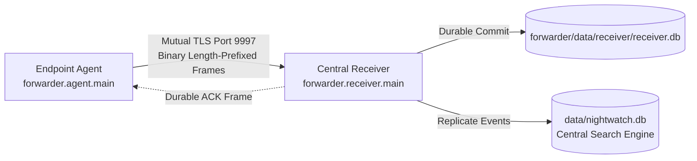

# NIGHTWATCH End-to-End Execution Guide

A comprehensive, step-by-step operational guide to running the entire **NIGHTWATCH** ecosystem: the **Core SIEM Platform & Web Console** and the **High-Performance mTLS Forwarder Subsystem**.

---

## 1. System Components Summary

The project consists of two seamlessly integrated tiers:

1. **NIGHTWATCH Core SIEM (`main.py`):**
   - Web application, REST API, and interactive SOC console running on `http://127.0.0.1:8000`.
   - SQLite FTS5 search engine (`data/nightwatch.db`) supporting 18+ Splunk-compatible SPL commands.
   - Built-in real-time endpoint collectors (native Windows Event Log tailing, host process telemetry, and UDP syslog listener).
   - Sliding-window correlation and security alert lifecycle triage.

2. **NIGHTWATCH Forwarder Subsystem (`forwarder/`):**
   - **Component A (Agent):** Ultra-lightweight endpoint agent collecting genuine OS logs (Linux text logs or Windows Event Logs), buffering in durable SQLite WAL local queues, and streaming over binary length-prefixed frames.
   - **Component B (Receiver):** Multi-threaded TCP listener on port `9997` requiring Mutual TLS (mTLS), cryptographic identity binding, deduplication, and sink replication directly into `data/nightwatch.db`.

---

## 2. Prerequisites & Environment Setup

### System Requirements
- **OS:** Windows 10/11, Windows Server, or Linux (Ubuntu, Debian, RHEL, Kali).
- **Python:** Python 3.10 or newer (tested on Python 3.13).
- **Hardware:** Minimal requirements (< 45 MB RAM idle, low CPU usage).

### Installation
Open a terminal in the project root directory (`d:\nightwatch`):

```bash
# 1. Install Core SIEM Dependencies
pip install -r requirements.txt

# 2. Install Forwarder & mTLS Dependencies
pip install -r forwarder/requirements.txt
```

---

## 3. Workflow A: Running the Core NIGHTWATCH SIEM Platform

This workflow starts the central NIGHTWATCH search engine, detection rules, and the web console.

### Step 1: Start the NIGHTWATCH Server

**On Windows:**
```powershell
python main.py
```
*(or run `.\run_nightwatch.bat`)*

**On Linux / macOS:**
```bash
python3 main.py
```
*(or run `./run_nightwatch.sh`)*

You will see output indicating the server has initialized:
```
INFO:     Started server process
INFO:     Waiting for application startup.
INFO:     NIGHTWATCH Storage Engine initialized at: data/nightwatch.db
INFO:     Application startup complete.
INFO:     Uvicorn running on http://127.0.0.1:8000 (Press CTRL+C to quit)
```

### Step 2: Access the Web Console
Open your browser and navigate to:
👉 **[http://127.0.0.1:8000](http://127.0.0.1:8000)**

### Step 3: Explore Features
- **Search Tab:** Run real-time SPL queries across all indexed logs:
  - `*` (display all recent events)
  - `sourcetype=windows_eventlog | stats count by severity`
  - `index=* | timechart span=1m count`
  - `sourcetype=process_telemetry | top 10 process_name`
- **Dashboard Tab:** Live KPI metrics, event velocity histograms, sourcetype donut charts, and host distributions.
- **Alerts Tab:** Inspect triggered threat detections (e.g. Brute Force attempts, Privilege Escalation). Change alert status (`New` → `Acknowledged` → `Investigating` → `Resolved`).
- **Data Inputs Tab:** View all active live collectors and stream statistics.

---

## 4. Workflow B: Running the NIGHTWATCH Forwarder & Receiver (mTLS Pipeline)

This workflow runs the standalone endpoint agent and central receiver over authenticated Mutual TLS (mTLS).



### Step 1: Generate PKI Certificates (mTLS)
Run the built-in PKI certificate utility to create a trusted Root CA, Receiver server certificate, and Agent client certificate:

```powershell
# 1. Initialize Root CA
python forwarder/scripts/issue_certificates.py init-ca --out-dir forwarder/certs/ca

# 2. Issue Receiver Server Certificate (CN: localhost, SAN: 127.0.0.1)
python forwarder/scripts/issue_certificates.py issue-server --ca-dir forwarder/certs/ca --out-dir forwarder/certs/server --hostname localhost --ip 127.0.0.1

# 3. Issue Endpoint Agent Certificate (CN: agent-win-01)
python forwarder/scripts/issue_certificates.py issue-agent --ca-dir forwarder/certs/ca --out-dir forwarder/certs/agent --agent-id agent-win-01
```

### Step 2: Start the Central Receiver
Open **Terminal 1** and start the mTLS receiver on TCP port `9997`:

```powershell
python -m forwarder.receiver.main --config forwarder/config/receiver.test.json
```
*The receiver will log that it is listening with mutual client certificate verification enforced.*

### Step 3: Run Endpoint Pre-flight Diagnostics
Before starting the agent, verify configuration, certificate expiration, log channel access, and receiver port connectivity:

```powershell
python forwarder/scripts/verify_installation.py --config forwarder/config/agent.test.json
```

You should see:
```
  [PASS] Operating System — Windows 11 / Linux
  [PASS] Certificate Expiration Check — Expires in 364 days
  [PASS] Windows Channel 'System' — Accessible
  [PASS] TCP Connectivity to 127.0.0.1:9997 — Port is open and accepting TCP connections
  RESULT: VERIFICATION PASSED. Agent is ready for live operation!
```

### Step 4: Start the Forwarder Agent
Open **Terminal 2** and start the agent:

```powershell
python -m forwarder.agent.main --config forwarder/config/agent.test.json
```

The agent will:
1. Open native OS channels (`System`, `Application` on Windows; or configured log files on Linux).
2. Commit records into local persistent SQLite queue (`forwarder/data/agent/queue.db`).
3. Negotiate an mTLS handshake with the receiver.
4. Transmit batches and retire events upon receiving validated receiver ACKs.

---

## 5. Workflow C: 1-Click Automated Demonstrations & Benchmarks

For instant automated validation of the end-to-end forwarder pipeline:

### 1. Live Telemetry Pipeline Test (1-Click Run)
Runs genuine Windows Event Log collection, starts an mTLS receiver on port 9997, streams events, commits to disk, validates ACKs, and inspects replicated entries in `data/nightwatch.db`:

```powershell
python forwarder/scripts/demo_live_pipeline.py
```

Expected output:
```
================================================================
   NIGHTWATCH Live Endpoint Telemetry Pipeline Demonstration    
================================================================
[1] Loading Receiver configuration and starting mTLS server on 127.0.0.1:9997...
    [+] Receiver started and listening with mutual TLS enforcement.
[2] Loading Agent configuration and starting Forwarder Agent Service...
    [+] Forwarder Agent active. Polling native OS telemetry sources...
[3] Collecting genuine endpoint events and transmitting over mTLS (6 seconds)...
    Elapsed: 1s | Agent Pending Queue: 313 | Receiver Accepted: 100
    Elapsed: 2s | Agent Pending Queue: 323 | Receiver Accepted: 300
    ...
[5] Verifying Receiver Durable SQLite Store (forwarder/data/receiver/receiver.db):
    [+] Total unique endpoint events persisted: 900
[6] Verifying Central NIGHTWATCH Search Engine Replication (data/nightwatch.db):
    [+] Total forwarder telemetry events indexed in NIGHTWATCH core: 900
================================================================
   LIVE TELEMETRY DEMONSTRATION & VERIFICATION COMPLETED: PASS  
================================================================
```

### 2. Measure Host Resource Utilization & Throughput
Measures real memory consumption (RSS), CPU usage, and wire throughput on the host machine:

```powershell
python forwarder/scripts/measure_resources.py
```

Expected output:
```
---------------- Resource Utilization Results ------------------
  Target Platform:             win32 / linux
  Average CPU Utilization:     5.92%
  Peak RSS Working Set Memory: 44.85 MB (Baseline: 38.37 MB)
  Memory Footprint Delta:      +6.48 MB
  Persistent Queue Disk Size:  1316.0 KB
  Delivery Throughput:         159.8 events/sec
----------------------------------------------------------------
```

### 3. Run Complete Automated Test Suite (24 Tests)
Runs all unit and integration tests (protocol framing, checkpointing, queue resilience, mTLS handshake, deduplication, schema validation):

```powershell
python -m pytest forwarder/tests -v
```

---

## 6. Searching Forwarded Telemetry in NIGHTWATCH UI

When the Forwarder is running alongside the NIGHTWATCH server, all events transmitted by endpoints are immediately available for search in the web console:

1. Navigate to **[http://127.0.0.1:8000](http://127.0.0.1:8000)**.
2. Enter any of the following queries in the Search box:

```spl
# View all forwarded endpoint events
category="endpoint_telemetry"

# Break down events by endpoint host and channel
sourcetype="forwarder" | stats count by host, source

# Find top Windows Event IDs received from agents
sourcetype="forwarder" | top 10 source_event_id

# Timechart of incoming forwarded events over time
category="endpoint_telemetry" | timechart span=1m count
```

---

## 7. 1-Command Forwarder Deployment on Any Remote Machine

When another user clones your GitHub repository on their computer (Windows or Linux), they can stream their real-time operating system logs directly into your dashboard with **one simple command**:

### On the Remote Machine:
```bash
# 1. Clone the repository
git clone https://github.com/amara-narayana/nightwatch.git
cd nightwatch

# 2. Run the forwarder targeting your server IP
python run_forwarder.py --server <YOUR_SERVER_IP>
```
*(e.g., `python run_forwarder.py --server 192.168.1.50`)*

If they run `python run_forwarder.py` without arguments, the script will interactively ask:
`Enter NIGHTWATCH Server IP or Hostname [e.g. 192.168.1.50]: `

### What Happens Automatically:
1. **Self-Enrollment:** The agent contacts `http://<YOUR_SERVER_IP>:8000/api/forwarder/enroll`.
2. **Dynamic Certificate Issuance:** Your central server dynamically generates and signs a secure mTLS client certificate for that remote machine using your server's private Root CA.
3. **Source Detection:** The script detects the remote OS:
   - On Windows: Automatically tails `System`, `Application`, and `Security` event logs.
   - On Linux: Automatically streams `/var/log/auth.log`, `syslog`, `secure`, or `messages`.
4. **Encrypted Transport:** The agent connects to your server's receiver port `9997` via authenticated Mutual TLS and starts streaming genuine OS telemetry in real time.
5. **Dashboard Visibility:** Open your dashboard at `http://<YOUR_SERVER_IP>:8000` — the remote user's logs immediately appear under their machine hostname!

---

## 8. Manual Multi-Device Deployment (Air-Gapped / Static Environments)

For air-gapped environments without HTTP enrollment:

### 1. Server Configuration (Device A - IP: `192.168.1.50`)
1. Open Firewall Port 9997 on Device A:
   - **Windows:**
     ```powershell
     netsh advfirewall firewall add rule name="NIGHTWATCH Receiver Port 9997" dir=in action=allow protocol=TCP localport=9997
     ```
   - **Linux:**
     ```bash
     sudo ufw allow 9997/tcp comment "NIGHTWATCH Receiver mTLS"
     ```
2. Generate an agent certificate for Device B:
   ```powershell
   python forwarder/scripts/issue_certificates.py issue-agent `
     --ca-dir forwarder/certs/ca `
     --out-dir forwarder/certs/agent `
     --agent-id agent-endpoint-b
   ```
3. Securely transfer `ca.crt`, `agent-endpoint-b.crt`, and `agent-endpoint-b.key` to Device B.

### 2. Endpoint Configuration (Device B)
1. Configure `forwarder/config/agent.json` on Device B:
   ```json
   {
     "agent_id": "agent-endpoint-b",
     "receiver_host": "192.168.1.50",
     "receiver_port": 9997,
     "ca_cert_path": "certs/ca.crt",
     "client_cert_path": "certs/agent-endpoint-b.crt",
     "client_key_path": "certs/agent-endpoint-b.key",
     "tls_verify_server": false
   }
   ```
2. Start the Agent on Device B:
   - **Interactive:** `python -m forwarder.agent.main --config forwarder/config/agent.json`
   - **Windows Service:** Run `forwarder/deployment/windows/install_agent_service.ps1`
   - **Linux Service:** Enable `forwarder/deployment/systemd/nightwatch-agent.service`

---

## 8. Troubleshooting & FAQ

| Symptom | Cause | Solution |
|---|---|---|
| `[WinError 10061] Connection refused` | Receiver is not running or listening on another IP/port | Ensure receiver is running (`forwarder.receiver.main`) and check `receiver_host`/`receiver_port` in `agent.json`. |
| `CERTIFICATE_VERIFY_FAILED: Missing Authority Key Identifier` | CA or Server certificate was generated without standard X.509 extensions | Use `forwarder/scripts/issue_certificates.py` which generates standard SubjectKeyIdentifier and AuthorityKeyIdentifier extensions. |
| `Identity mismatch / Forbidden` | Claimed `agent_id` in config does not match client certificate Common Name | Ensure `agent_id` in `agent.json` exactly matches the Common Name (CN) specified when running `issue-agent`. |
| `Permission denied` on `/var/log/auth.log` (Linux) | Agent user is not a member of the `adm` group | Run `sudo usermod -aG adm nightwatch` and restart the agent service. |
| Port 8000 already in use (Core SIEM) | Another instance of NIGHTWATCH is running | Check active processes with `netstat -ano \| findstr 8000` or change port in `main.py`. |

---

## 9. Distribution Archive

A standalone deployment package containing all agent and receiver files is available at:
📦 **[nightwatch-forwarder-v1.0.0.zip](file:///d:/nightwatch/nightwatch-forwarder-v1.0.0.zip)** (84 KB)
